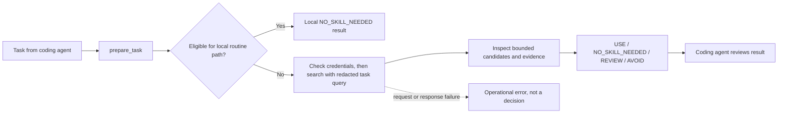

# SkillScraper

SkillScraper is an installable, local stdio [Model Context Protocol (MCP)](https://modelcontextprotocol.io/) server for coding agents. It helps them discover, inspect, and select relevant skills using evidence-based recommendations, then returns bounded evidence, compatibility information, safety signals, and unresolved questions for a developer to review.

Coding agents can miss useful skills, choose skills that only match a task's topic, or spend time searching when ordinary coding support is enough. SkillScraper provides a repeatable, evidence-based selection and inspection workflow. It is an MCP server, not a desktop application, and it does not intercept every prompt automatically.

## Capabilities

- **Prepare a task:** evaluate task fit and return one of four outcomes: `USE`, `NO_SKILL_NEEDED`, `REVIEW`, or `AVOID`.
- **Inspect a candidate:** check bounded skill content, project compatibility, local scanner findings, and available external audit evidence.
- **Explain uncertainty:** distinguish missing, incomplete, stale, or revision-mismatched evidence from evidence that supports a decision.
- **Stay read-only:** SkillScraper does not install, activate, import, or execute skills, edit project files, or change agent configuration. Returned excerpts and catalog metadata are untrusted evidence.
- **Use local paths where possible:** `doctor` is local-only. A deterministic routine-task fast path can return `NO_SKILL_NEEDED` without catalog access.
- **Evaluate offline:** calibration tools run against local fixtures and support independent human reviews, adjudication, and a held-out split.

The optional Codex prompt hook is a separate integration. It is not needed for MCP use and automatic routing has not been verified in a trusted Codex host session. The optional LLM adapter is disabled by default and is not used by MCP requests.

## How it works



`NO_SKILL_NEEDED` can also follow a complete catalog search when no candidate meets the current relevance policy. An incomplete search or failed request is not evidence that no skill is useful. `USE` is not a safety guarantee: the current policy also requires task-specific operation evidence, supported compatibility, complete inspected content, and passing audit evidence bound to that content revision.

| Outcome | Meaning |
| --- | --- |
| `USE` | Current policy found sufficient task-fit, compatibility, content, and audit evidence. Review the evidence before relying on it. |
| `NO_SKILL_NEEDED` | A local routine fast path applies, or a complete search found no sufficiently supported candidate. |
| `REVIEW` | Relevance or material evidence remains uncertain, incomplete, stale, or unavailable. |
| `AVOID` | A current hard-blocking local finding or external audit applies to a candidate. |

## Install

Requires Python 3.12 or newer. The project is **not published on PyPI or another public package registry**. External pilot installation currently requires a wheel supplied by the project through an approved distribution channel; no public download URL is available.

Install a supplied wheel in an isolated environment. Replace the wheel path with the file provided to you:

```bash
PILOT_VENV="$HOME/.venvs/skillscraper-pilot"
python3.12 -m venv "$PILOT_VENV"
"$PILOT_VENV/bin/python" -m pip install /path/to/project-supplied/skillscraper-0.1.0-py3-none-any.whl
"$PILOT_VENV/bin/python" -m pip check
"$PILOT_VENV/bin/skillscraper" --version
"$PILOT_VENV/bin/skillscraper" doctor
```

Pip may need access to your configured package index for the wheel's declared dependencies. `doctor` reports local configuration only; it does not test catalog connectivity or whether a credential works. The [developer pilot guide](docs/developer-pilot.md) has Windows paths and the complete pilot procedure.

The canonical distribution and CLI are named `skillscraper`. The Python import package remains `skillscout` for existing imports. The existing `skillscout`, `skillscout-mcp`, and `skillscout-codex-hook` executable names, `SKILLSCOUT_*` environment variables, and `skillscout` MCP configuration ID remain supported for compatibility; existing installations and configurations do not need to be renamed.

## Connect Codex CLI over MCP

SkillScraper serves MCP over local stdin/stdout through the compatible `skillscout-mcp` executable. Its advertised server name is SkillScraper; the tools remain `prepare_task`, `inspect_skill`, and `doctor`. A Codex CLI session has exercised all three tools with synthetic inputs; this verifies a sample invocation, not automatic selection or invocation on every task. The [Codex MCP guide](https://developers.openai.com/codex/mcp) documents the configuration format.

Add this server entry to `~/.codex/config.toml`, merging it with existing settings. The `skillscout` key and `skillscout-mcp` command are retained so existing configurations continue to work. Use the absolute path to the executable in the environment where you installed SkillScraper:

```toml
[mcp_servers.skillscout]
command = "/absolute/path/to/skillscraper-pilot/bin/skillscout-mcp"
env_vars = ["SKILLSCOUT_CATALOG_TOKEN", "VERCEL_OIDC_TOKEN"]
```

Restart Codex, check registration with `codex mcp list`, and use `/mcp` in a Codex session to confirm the server is connected. The MCP tools are:

- `prepare_task(task, project_path?, agent?, context_budget_bytes?)`
- `inspect_skill(skill_id, project_path?)`
- `doctor()`

SkillScraper requires a configured bearer token before it sends catalog search, detail, or audit requests. It reads `SKILLSCOUT_CATALOG_TOKEN` first and falls back to `VERCEL_OIDC_TOKEN`; if both are non-empty, `SKILLSCOUT_CATALOG_TOKEN` takes precedence. These values must be present in the server process environment at startup. The `env_vars` line allowlists the names for the server; provide values through an approved secret manager or environment-injection mechanism. Do not put a credential value in Codex configuration, a prompt, or a report. Restart Codex after changing the environment or renewing a token. `doctor` reports whether a credential is configured but does not validate it.

### Optional Codex hook

The package also provides the compatibility executable `skillscout-codex-hook` for the Codex `UserPromptSubmit` event. It is opt-in and distinct from MCP configuration. Registration, trust, and actual host-level execution remain unverified; do not rely on it for automatic routing. See [release-candidate verification](docs/release-candidate-verification-2026-10-25.md) and the official [Codex hooks guide](https://developers.openai.com/codex/hooks) before trying it in a disposable project. Do not enable an all-prompts hook for sensitive task text.

## First use

Run the local diagnostics and routine fast path:

```bash
PILOT_VENV="$HOME/.venvs/skillscraper-pilot"
"$PILOT_VENV/bin/skillscraper" doctor
"$PILOT_VENV/bin/skillscraper" recommend \
  "Rename a local variable in a Python helper function." --format json
```

The routine task should return `NO_SKILL_NEEDED` without contacting the catalog. To check the MCP connection in Codex, ask it explicitly:

```text
Use only the SkillScraper MCP server. Call doctor, then call prepare_task with task exactly
"Rename a local variable in a Python helper function." Report the tool status and decision.
Do not read or modify project files.
```

For specialist selection and inspection, use the reproducible synthetic tasks in the [pilot guide](docs/developer-pilot.md). A non-routine recommendation or `inspect_skill` uses the remote catalog. The current client checks locally for a configured credential before sending catalog requests. Without one, it returns an operational `catalog_credentials_missing` error and makes no catalog request; do not interpret this as a successful empty search or `NO_SKILL_NEEDED`. Authenticated live catalog behavior has not been verified. Catalog-backed search sends a redacted task query to the service; redaction is heuristic, so use only synthetic or non-sensitive task text until you have reviewed what will be sent. Project source files are not sent.

## Current status and limitations

- Recommendation quality has not been established by genuine human-reviewed labels. The current proposal has 32 pending development examples and 8 held-out examples; synthetic smoke tests are separate and do not establish real-world accuracy.
- Automatic routing is unverified until the optional Codex hook is registered, trusted, and exercised in a real host session.
- Codex CLI MCP tool invocation has been exercised on synthetic inputs. Claude Code integration has not been exercised in a Claude Code session and is not advertised as verified.
- No authenticated live catalog search or inspection has been verified. The current client requires a configured credential before catalog-backed requests.
- No public package release has been confirmed.

## Development and evaluation

From a source checkout, install the development dependencies and run local checks:

```bash
uv sync --all-extras
uv run skillscraper doctor
uv run pytest
```

The standard tests use fixtures and are software checks, not recommendation-quality measurements. Validate the proposed review dataset offline with:

```bash
uv run python -m skillscout.evaluation calibrate validate \
  docs/calibration/v2/proposed-dataset.json
```

The [calibration guide](docs/calibration/README.md) explains the append-only review ledger, two independent reviewer labels, disagreement adjudication, development-only reports, held-out protection, and metrics. Keep held-out examples sealed during tuning. The latest recorded report found zero human-reviewed examples.

## Documentation and open verification work

- [Developer pilot guide](docs/developer-pilot.md) — install, Codex MCP setup, sample tasks, and sanitized feedback template.
- [Manual catalog demo](docs/manual-catalog-demo.md) — an explicit live request, separate from offline tests and requiring an authorized credential.
- [Calibration and human review](docs/calibration/README.md) — evaluation workflow, review requirements, and metric definitions.
- [Release-candidate verification](docs/release-candidate-verification-2026-10-25.md) — verified baseline and release blockers.
- [Troubleshooting](docs/troubleshooting.md), [security model](docs/security-model.md), and [limitations](docs/limitations.md).
- [Verification history](docs/verification.md) and [release readiness](docs/release-readiness-2026-10-24.md).

Remaining verification work includes an authenticated live catalog check, trusted Codex hook host execution, Claude Code client testing, genuine independent recommendation reviews, and an owner decision on licensing. These are open checks, not completed capabilities or public reliability claims.

## License and contributions

The repository currently has no `LICENSE` file or project license metadata. The owner has not granted a general right to reuse or redistribute the project; do not assume that such rights exist. Contribution and redistribution terms also remain unresolved. See the [licensing investigation](docs/release-candidate-verification-2026-10-25.md#licensing-investigation); a project owner decision is required before these terms can be stated.
